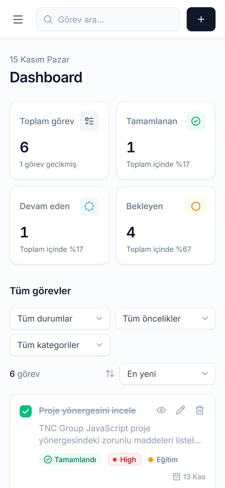

# TaskFlow – Modern Görev Yönetimi

[](https://spectacular-moonbeam-ec77dc.netlify.app)
[](https://github.com/TPertev/taskflow-todo)

**🚀 Canlı demo:** **[spectacular-moonbeam-ec77dc.netlify.app](https://spectacular-moonbeam-ec77dc.netlify.app)**

TaskFlow, React + Vite + Tailwind CSS ile geliştirilmiş, verileri tarayıcının **LocalStorage** alanında saklayan, sade ve modern bir görev yönetim (TODO) uygulamasıdır. Bu proje, **TNC Group Web Geliştirme – JavaScript Proje Yönergesi** kapsamında geliştirilmiştir ve CRUD (Create, Read, Update, Delete) işlemlerinin tamamını içerir.


<p align="center">
  
</p>

---

## Kullanılan Teknolojiler

| Teknoloji | Kullanım amacı |
| --- | --- |
| **React 19** | Bileşen tabanlı arayüz |
| **Vite 8** | Geliştirme sunucusu ve production build |
| **JavaScript (ES6+)** | Uygulama mantığı (TypeScript kullanılmadı) |
| **Tailwind CSS 4** | Stil ve responsive tasarım |
| **HTML5 / CSS3** | Semantik yapı, erişilebilirlik, animasyon |
| **LocalStorage** | Kalıcı veri saklama (backend gerektirmez) |
| **Lucide React** | Tutarlı ikon seti |
| **ESLint** | Kod kalitesi kontrolü |

## Özellikler

**Zorunlu CRUD işlemleri**
- **Create:** Başlık, açıklama, öncelik, kategori, son tarih ve durum alanlarıyla görev oluşturma; form doğrulama ve anlaşılır hata mesajları.
- **Read:** Tüm görevlerin kart görünümünde listelenmesi, görev detay penceresi.
- **Update:** Tüm alanların düzenlenmesi + tek tıkla tamamlandı / bekliyor geçişi.
- **Delete:** Onay penceresi ile güvenli silme.

**Ek özellikler**
- Dashboard istatistikleri: toplam, tamamlanan, devam eden, bekleyen görev sayıları
- Öncelik seviyeleri (Low / Medium / High) ve 5 kategori
- Durumlar: Bekliyor / Devam ediyor / Tamamlandı
- Başlık ve açıklamada anlık arama
- Duruma, önceliğe ve kategoriye göre filtreleme
- Sıralama: en yeni, en eski, son tarih, öncelik, başlık (A–Z)
- Son tarih gösterimi (“Bugün”, “Yarın”, “3 gün kaldı”, “2 gün gecikti”)
- Sidebar görünümleri: Tüm görevler, Bugün, Yaklaşan (7 gün), Gecikmiş
- Tamamlanma oranı ilerleme çubuğu
- Toast bildirimleri, boş liste ve yükleme (skeleton) ekranları
- Responsive sidebar (mobilde açılır çekmece)
- Erişilebilirlik: etiketli form alanları, `aria-*` öznitelikleri, klavye ile kullanılabilir modallar (Esc, odak tuzağı), “İçeriğe geç” bağlantısı, `prefers-reduced-motion` desteği

## Kurulum

Gereksinim: **Node.js 20.19+** (veya 22+) ve npm.

```bash
git clone https://github.com/TPertev/taskflow-todo.git
```

```bash
cd taskflow-todo
```

```bash
npm install
```

## Çalıştırma

| Komut | Açıklama |
| --- | --- |
| `npm run dev` | Geliştirme sunucusunu başlatır (varsayılan: http://localhost:5173) |
| `npm run build` | Production build'i `dist/` klasörüne üretir |
| `npm run preview` | Build çıktısını yerelde önizler |
| `npm run lint` | ESLint ile kod kontrolü yapar |

## Proje Klasör Yapısı

```
taskflow-todo/
├── public/
│   └── favicon.svg
├── docs/
│   └── screenshots/              # README ekran görüntüleri
├── src/
│   ├── components/
│   │   ├── dashboard/            # StatsGrid, StatCard
│   │   ├── layout/               # AppLayout, Sidebar, Header
│   │   ├── tasks/                # TaskList, TaskCard, TaskForm, modallar, filtre çubuğu
│   │   └── ui/                   # Button, Modal, Select, FormField, EmptyState, ToastProvider
│   ├── context/                  # ToastContext
│   ├── data/                     # İlk açılış örnek görevleri
│   ├── hooks/                    # useTasks (CRUD), useToast
│   ├── interfaces/               # Task veri sözleşmesi (JSDoc) ve sabitler
│   ├── pages/                    # DashboardPage
│   ├── services/                 # storageService (LocalStorage), taskService
│   ├── utils/                    # Tarih, doğrulama, filtre/sıralama yardımcıları
│   ├── App.jsx
│   ├── index.css
│   └── main.jsx
├── eslint.config.js
├── index.html
├── netlify.toml
├── package.json
├── vite.config.js
├── PROJECT_DOCUMENTATION.md
└── README.md
```

Ayrıntılı teknik açıklama için: [PROJECT_DOCUMENTATION.md](PROJECT_DOCUMENTATION.md)

## Netlify ile Yayınlama

Proje kökündeki `netlify.toml` dosyası gerekli ayarları içerir:

- **Build command:** `npm run build`
- **Publish directory:** `dist`
- **Node sürümü:** 22

Netlify panelinde **Add new site → Import an existing project → GitHub** adımlarıyla repoyu seçmeniz yeterlidir; ayarlar otomatik okunur.

Proje şu adreste yayındadır: **https://spectacular-moonbeam-ec77dc.netlify.app** — `main` dalına yapılan her push sonrası Netlify otomatik olarak yeniden yayınlar.

## Lisans

Bu proje eğitim amaçlı geliştirilmiştir.
